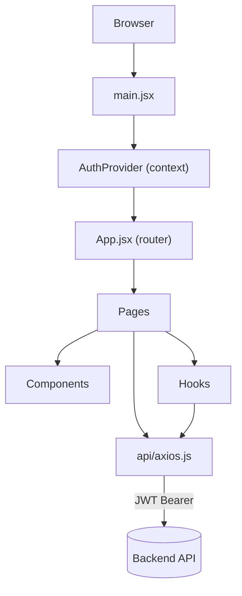
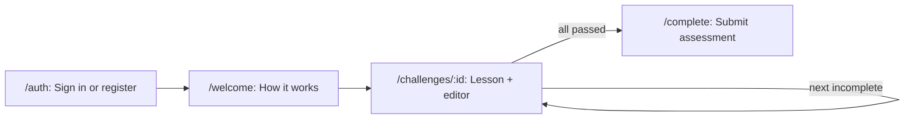

# Code Platoon Assessment — Front End

A React single-page app where Code Platoon applicants sign in, read a short Python mini-lesson, write a solution in an in-browser code editor, and run it against the backend to pass a series of coding challenges. Progress is saved automatically, and once every challenge is passed the applicant submits their completed assessment.

## Tech Stack

| Concern | Choice |
|---|---|
| UI | React 19 |
| Build / dev server | Vite 8 + `@vitejs/plugin-react` |
| Routing | `react-router-dom` 7 |
| HTTP | `axios` (with JWT + refresh interceptors) |
| Code editor | `@monaco-editor/react` (Python mode) |
| Linting | ESLint 10 (flat config) with react-hooks and react-refresh plugins |
| Hosting | Vercel (SPA rewrite in `vercel.json`) |

Requires a Node version supported by Vite 8 (20.19+ or 22.12+).

## Getting Started

```bash
npm install
npm run dev       # http://localhost:5173
```

The app expects the backend API on `http://localhost:8000`. In development Vite proxies `/api` to it (see `vite.config.js`), and the axios client falls back to the same URL.

### Environment variables

| Variable | Purpose | Default |
|---|---|---|
| `VITE_API_BASE_URL` | Base URL of the backend API | `http://localhost:8000` |

Set it in `.env` (or the hosting provider's environment settings) for deployed builds.

### Scripts

| Script | What it does |
|---|---|
| `npm run dev` | Start the Vite dev server with HMR |
| `npm run build` | Produce a production build in `dist/` |
| `npm run preview` | Serve the production build locally |
| `npm run lint` | Run ESLint over the project |

## Architecture at a Glance



## User Flow



## Project Structure

```
front-end/
├── docs/                  Detailed documentation (start with docs/README.md)
├── public/                Static assets (favicon, walkthrough screenshots in guide/)
├── src/
│   ├── main.jsx           Entry point; mounts AuthProvider + App
│   ├── App.jsx            Route table
│   ├── api/axios.js       Configured axios instance + token refresh
│   ├── context/           AuthContext (login state)
│   ├── hooks/             useChallenges, useDebounce
│   ├── components/        ProtectedRoute, ProgressBar, MiniLesson, EditorPane, Loader
│   ├── pages/             AuthPage, WelcomePage, ChallengePage, CongratsPage
│   └── styles/global.css  Design tokens and responsive rules (imported by index.css)
├── vite.config.js         Dev proxy for /api
├── vercel.json            SPA rewrite so deep links resolve to index.html
└── eslint.config.js
```

## Documentation

| Doc | Covers |
|---|---|
| [docs/README.md](docs/README.md) | Index of all docs |
| [docs/architecture.md](docs/architecture.md) | App bootstrap, provider tree, data flow |
| [docs/routing.md](docs/routing.md) | Route table, redirects, route guarding |
| [docs/authentication.md](docs/authentication.md) | AuthContext, token storage, refresh flow |
| [docs/api.md](docs/api.md) | Backend endpoints the front end calls |
| [docs/pages.md](docs/pages.md) | Each page and its behavior |
| [docs/components.md](docs/components.md) | Reusable components |
| [docs/hooks.md](docs/hooks.md) | Custom hooks |
| [docs/styling.md](docs/styling.md) | Design tokens, CSS, responsive layout |
| [docs/build-and-deploy.md](docs/build-and-deploy.md) | Tooling, environment, Vercel deployment |
