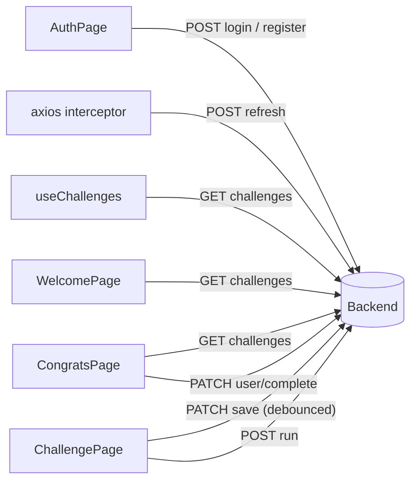
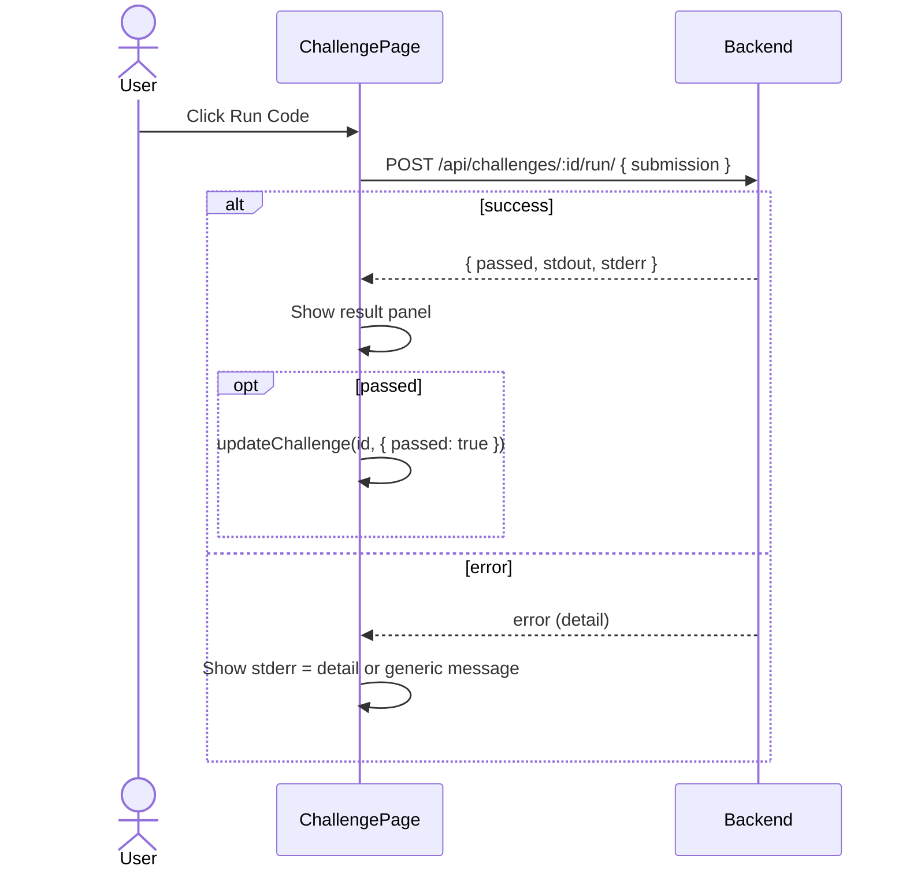

# Backend API Usage

All requests go through the shared axios instance in `src/api/axios.js`.

- **Base URL:** `import.meta.env.VITE_API_BASE_URL`, defaulting to `http://localhost:8000`.
- **Dev proxy:** `vite.config.js` also proxies `/api` to `http://localhost:8000`.
- **Auth header:** added automatically; see [authentication.md](authentication.md).

## Endpoints

| Method | Path | Called from | Request body | Response (fields used) |
|---|---|---|---|---|
| POST | `/api/auth/register/` | `AuthPage` | `{ email, password }` | `{ access, refresh }` |
| POST | `/api/auth/login/` | `AuthPage` | `{ email, password }` | `{ access, refresh }` |
| POST | `/api/auth/refresh/` | axios interceptor | `{ refresh }` | `{ access }` |
| GET | `/api/challenges/` | `useChallenges`, `WelcomePage`, `CongratsPage` | — | Array of `{ id, passed, submission, challenge: { init_temp, ... } }` |
| PATCH | `/api/challenges/:id/save/` | `ChallengePage` | `{ submission }` | — (status only) |
| POST | `/api/challenges/:id/run/` | `ChallengePage` | `{ submission }` | `{ passed, stdout, stderr }` |
| PATCH | `/api/user/complete/` | `CongratsPage` | — | — (status only) |

The refresh call uses bare `axios` (not the configured instance) so it bypasses the interceptors.

## Who calls what

## Run-code request lifecycle

## Error handling conventions

- Auth errors read `err.response.data.detail`, then field errors (`email[0]`, `password[0]`).
- Run errors map `detail` into the `stderr` slot of the result panel.
- `useChallenges` stores `err.message` in its `error` state.
- A failed challenge fetch on `WelcomePage` / `CongratsPage` redirects to `/auth`.
