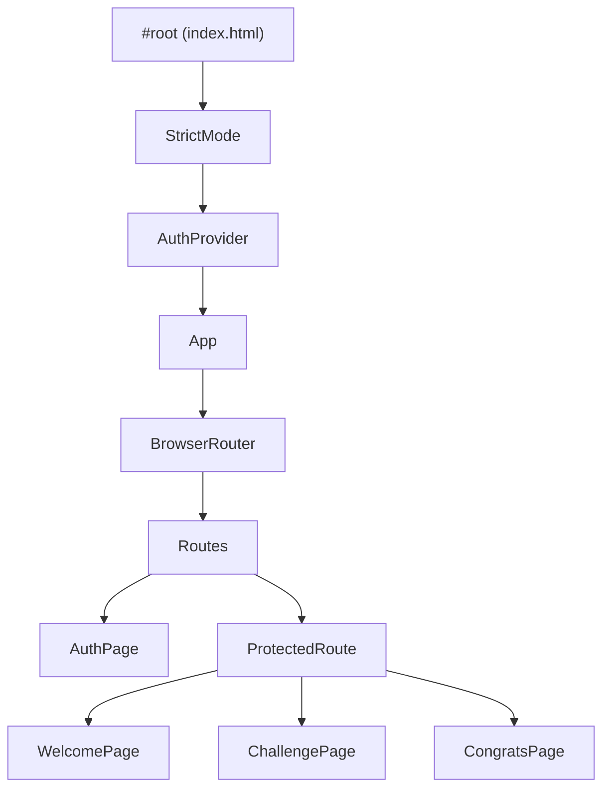
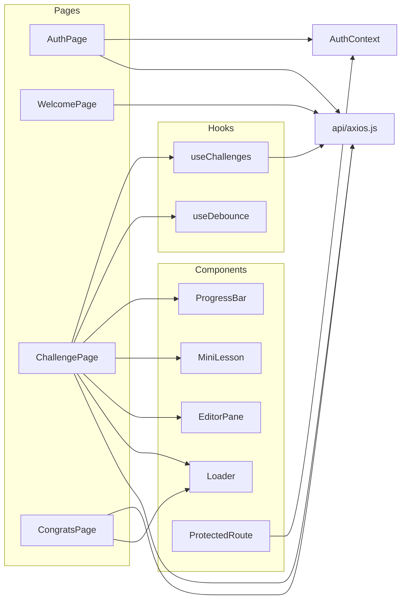

# Architecture

The app is a client-rendered React SPA. All state lives either in React component state, the `AuthContext`, or `localStorage` (JWT tokens). There is no global store; server data is fetched per page.

## Bootstrap

`src/main.jsx` mounts the tree in `StrictMode`, wrapping the app in `AuthProvider` so any component can call `useAuth()`. `src/index.css` is imported there and pulls in `styles/global.css`.



## Module dependencies



## Data model (as consumed by the UI)

The backend returns a list of per-user challenge records from `GET /api/challenges/`. The fields the UI relies on:

```mermaid
classDiagram
    class UserChallenge {
        id: string
        passed: boolean
        submission: string
        challenge: Challenge
    }
    class Challenge {
        init_temp: string
        (lesson content shown by MiniLesson)
    }
    UserChallenge --> Challenge
```

`ChallengePage` seeds the editor from `submission` (saved work) or falls back to `challenge.init_temp` (starter template).

## Design notes

- **Server is the source of truth for progress.** `passed` comes from the API; the UI only optimistically flips it locally (via `updateChallenge`) after a successful run.
- **Auth is token-in-localStorage.** See [authentication.md](authentication.md).
- **Inline styles dominate.** Component styling is mostly inline objects driven by CSS variables; shared tokens and responsive rules live in `global.css`. See [styling.md](styling.md).
