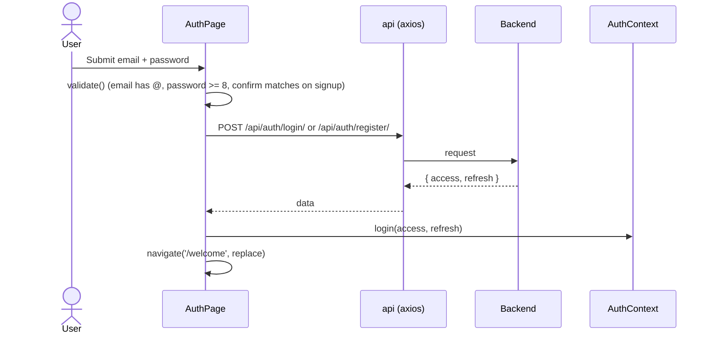
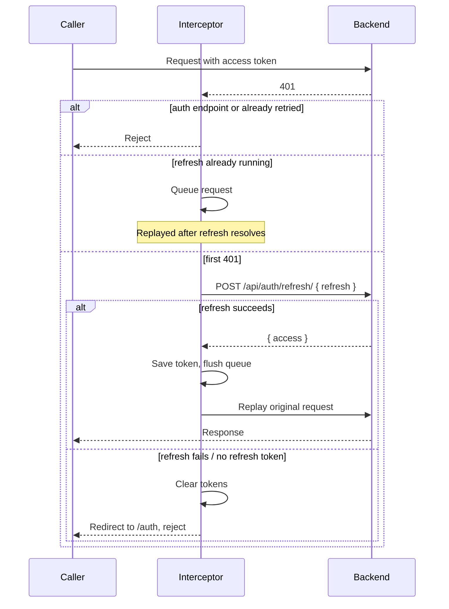

# Authentication

Authentication uses JWT access/refresh tokens issued by the backend. Two pieces cooperate: `AuthContext` (UI state) and the axios instance (token attachment and refresh).

## AuthContext (`src/context/AuthContext.jsx`)

`AuthProvider` initializes `accessToken` from `localStorage['access_token']` and exposes:

| Value | Description |
|---|---|
| `isAuthenticated` | `true` when an access token exists |
| `accessToken` | Current access token (state copy) |
| `login(access, refresh)` | Stores both tokens in `localStorage` and updates state |
| `logout()` | Removes both tokens and clears state |

`useAuth()` throws if used outside `AuthProvider`.

`localStorage` keys: `access_token`, `refresh_token`.

## Sign-in flow

Errors are surfaced from `detail`, `email[0]`, or `password[0]` in the response, with a generic fallback.

## Token handling in axios (`src/api/axios.js`)

- **Request interceptor:** reads `access_token` from `localStorage` on every request and sets `Authorization: Bearer <token>`.
- **Response interceptor:** on a `401`, attempts a single refresh and replays the failed request.
  - Requests to URLs containing `/api/auth/` are never retried (avoids loops on bad login credentials).
  - Each request is retried at most once (`_retry` flag).
  - While a refresh is in flight, other 401'd requests are queued in `failedQueue` and replayed with the new token once it arrives.
  - If there is no refresh token, or refreshing fails, both tokens are removed and the browser is sent to `/auth` via `window.location.href`.

## Caveats

- The refresh and forced-redirect paths update `localStorage` directly and use `window.location.href`, so `AuthContext` state is reset by the full page load rather than by calling `logout()`.
- Tokens in `localStorage` are readable by any script on the page; keep third-party scripts minimal.
- `logout()` exists in the context but no component currently calls it.
