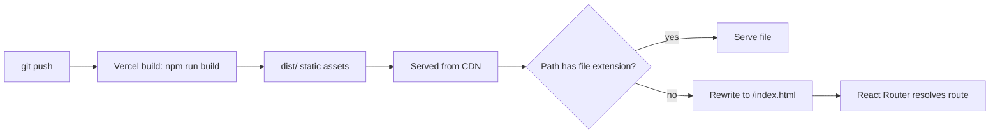

# Build, Tooling, and Deployment

## Scripts

| Script | Command | Notes |
|---|---|---|
| `dev` | `vite` | Dev server with HMR |
| `build` | `vite build` | Outputs to `dist/` |
| `preview` | `vite preview` | Serves the built output |
| `lint` | `eslint .` | `dist/` is ignored |

## Dependencies

**Runtime:** `react`, `react-dom`, `react-router-dom`, `axios`, `@monaco-editor/react`.

**Dev:** `vite`, `@vitejs/plugin-react`, `eslint`, `@eslint/js`, `eslint-plugin-react-hooks`, `eslint-plugin-react-refresh`, `globals`, `@types/react`, `@types/react-dom`.

`package.json` also has `overrides` for `dompurify` and `minimatch`. These force patched versions of transitive dependencies (from `monaco-editor` and `eslint`) to clear security advisories. They can be removed once upstream releases pick up the fixes. Run `npm audit` to check.

## Vite config (`vite.config.js`)

- Uses `@vitejs/plugin-react`.
- Dev server proxies `/api` to `http://localhost:8000` with `changeOrigin: true`.

## ESLint config (`eslint.config.js`)

Flat config applied to `**/*.{js,jsx}`, extending ESLint recommended, react-hooks recommended, and the react-refresh Vite preset. `no-unused-vars` is an error, except for names starting with an uppercase letter or underscore.

## Environment

| Variable | Used in | Default |
|---|---|---|
| `VITE_API_BASE_URL` | `src/api/axios.js` | `http://localhost:8000` |

Vite inlines `VITE_*` variables into the client bundle at build time, so they are public. Never put secrets in them.

## Deployment flow

Set `VITE_API_BASE_URL` in the Vercel project settings to the production API URL. In production there is no Vite proxy, so the backend must allow cross-origin requests (CORS) from the front end's origin.
