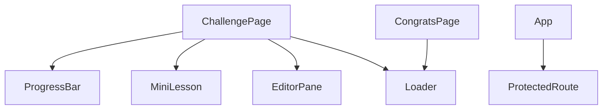
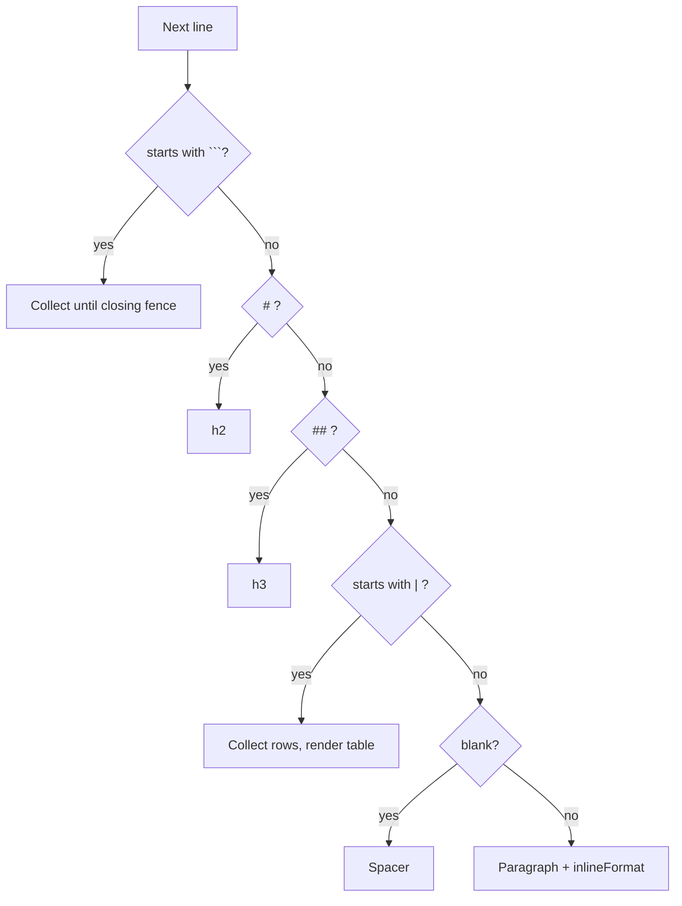

# Components

Reusable pieces in `src/components/`.



## ProtectedRoute

Layout route guard. Renders `<Outlet />` if `useAuth().isAuthenticated`, else `<Navigate to="/auth" replace />`. See [routing.md](routing.md).

## ProgressBar

Props: `challenges` (array), `currentId` (string).

Renders one chevron-shaped segment per challenge using `clipPath`. Each segment is numbered and labeled by status:

| Status | Rule | Label | Color |
|---|---|---|---|
| active | `sc.id === currentId` | In Progress | orange |
| completed | `sc.passed` (and not current) | Complete | green |
| future | otherwise | Locked | grey |

The current challenge always shows as active, even if it is already passed.

## MiniLesson

Prop: `content` (string of lesson markdown).

A small purpose-built markdown renderer (no external markdown library). It is parsed line by line and supports:

| Syntax | Output |
|---|---|
| ```` ``` ```` fenced block | Styled `<pre><code>` |
| `# Heading` | `<h2>` |
| `## Heading` | `<h3>` |
| `\| a \| b \|` table rows | Table (first row is the header; separator row skipped) |
| blank line | Spacer |
| anything else | Paragraph |
| `**bold**`, `` `code` `` (inline) | `<strong>`, styled `<code>` |

Unsupported: lists, links, images, italics, nested formatting, and `###` or deeper headings (these render as paragraphs). Output is built from React elements, not `dangerouslySetInnerHTML`, so lesson text is not interpreted as HTML.



## EditorPane

Props: `value`, `onChange`.

Thin wrapper around Monaco (`@monaco-editor/react`) configured for Python: `vs-dark` theme, 14px font, no minimap, word wrap on, 4-space tabs, `automaticLayout` so it resizes with its container.

## Loader

No props. A centered full-viewport spinner using the theme's stealth and orange colors. It injects its own `@keyframes spin` rule.
