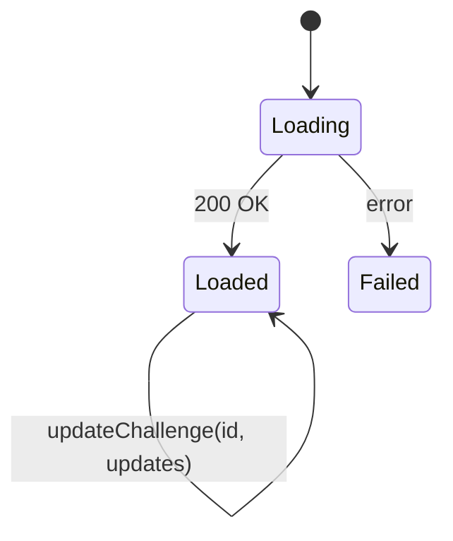
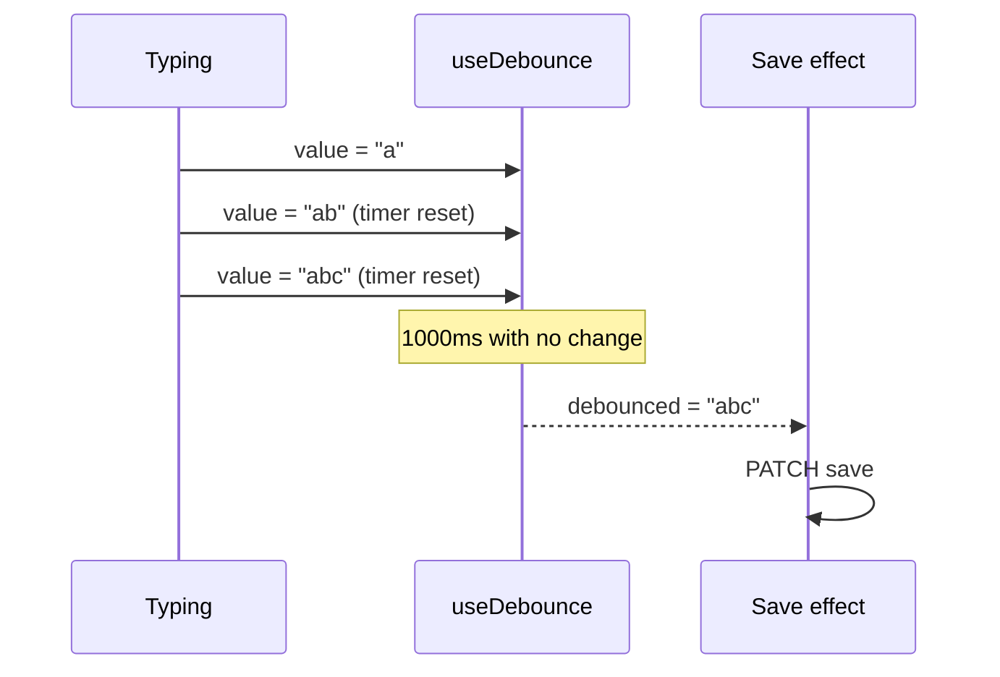

# Hooks

Custom hooks in `src/hooks/`, plus the `useAuth` hook from `AuthContext`.

## useChallenges

```js
const { challenges, loading, error, updateChallenge } = useChallenges();
```

Fetches `GET /api/challenges/` once on mount.

| Return | Description |
|---|---|
| `challenges` | Array of user-challenge records (initially `[]`) |
| `loading` | `true` until the request settles |
| `error` | `null`, or `err.message` / `'Failed to load challenges'` |
| `updateChallenge(id, updates)` | Shallow-merges `updates` into the matching record in local state; does not call the API |



Each `ChallengePage` mount creates its own copy of this state, so navigating between challenges refetches.

## useDebounce

```js
const debounced = useDebounce(value, delay = 1000);
```

Returns `value` after it has stopped changing for `delay` ms. Each change resets a timer; the timer is cleared on unmount. `ChallengePage` uses it to throttle autosave to one request per second of idle typing.



## useAuth

Defined in `src/context/AuthContext.jsx`. Returns `{ isAuthenticated, login, logout, accessToken }` and throws outside `AuthProvider`. See [authentication.md](authentication.md).
