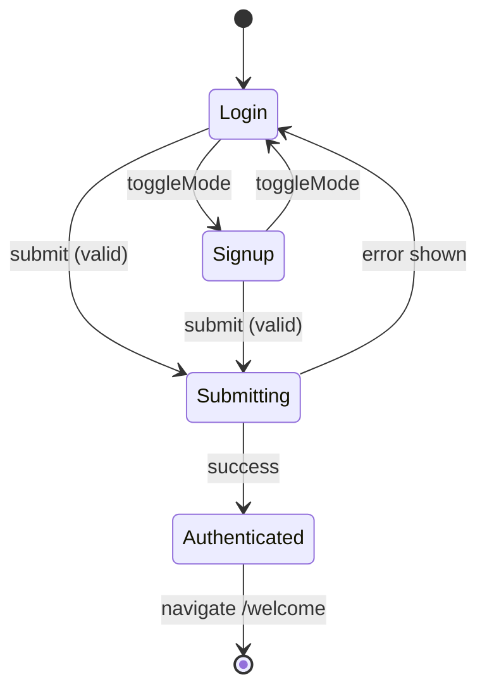
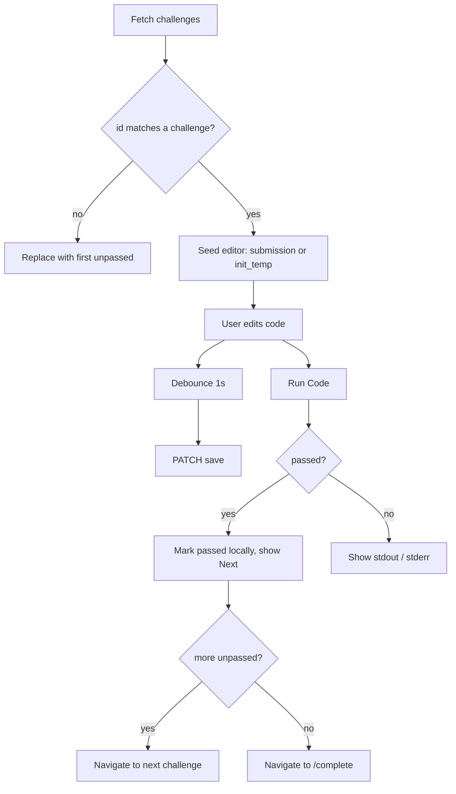

# Pages

Route-level components in `src/pages/`.

## AuthPage

Combined login / sign-up form.

- **State:** `mode` (`'login'` | `'signup'`), `email`, `password`, `confirmPassword`, `error`, `loading`.
- **Validation (client-side):** email must contain `@`; password at least 8 characters; on sign-up the confirmation must match.
- **Submit:** posts to `/api/auth/login/` or `/api/auth/register/`, calls `login(access, refresh)`, navigates to `/welcome`.
- **Redirect:** an effect sends already-authenticated users to `/welcome`.
- **Toggle:** switching mode clears the error and password fields.

## WelcomePage

Onboarding screen with a four-card walkthrough (`CARDS`: progress bar, mini-lesson, finding the challenge, writing and running code), each with a screenshot from `public/guide/`.

The start button fetches `/api/challenges/` and routes to the first unpassed challenge, or to `/complete` if everything is already passed. A fetch failure redirects to `/auth`.

## ChallengePage

The core screen. Reads `:id` from the URL and loads all challenges via `useChallenges`.

**Layout:** `ProgressBar` on top, then a two-pane split: `MiniLesson` on the left and `EditorPane` plus the output panel on the right. On narrow viewports (<= 768px) the panes become tabs (`mobileTab`: `lesson` | `editor`).

**State:** `code`, `saveStatus` (`''` | `'saving'` | `'saved'`), `runLoading`, `runResult` (`{ passed, stdout, stderr }`), `mobileTab`.

**Behavior**

1. **Invalid id redirect.** If challenges loaded but none match `:id`, navigate (replace) to the first unpassed challenge, or the first challenge.
2. **Seeding the editor.** When the current challenge changes, `code` is set to `submission || challenge.init_temp || ''` and `runResult` is cleared. A ref (`seededIdRef`) prevents re-seeding the same challenge.
3. **Autosave.** `code` is debounced by 1 second (`useDebounce`); a non-empty debounced value triggers `PATCH /api/challenges/:id/save/`. The status label shows "saving" then "saved" and clears after 2.5s.
4. **Run.** `POST /api/challenges/:id/run/` with the current code. A pass marks the challenge passed locally.
5. **Next.** Moves to the next unpassed challenge, or `/complete` when none remain.

## CongratsPage

Final screen. On mount it fetches `/api/challenges/`: if any challenge is unpassed it redirects to the first incomplete one; if the request fails it redirects to `/auth`. Otherwise it shows the completion summary (`OBJECTIVES`) and a submit button that calls `PATCH /api/user/complete/`. Success sets `submitted`; failure shows the server `detail` or a generic message.
