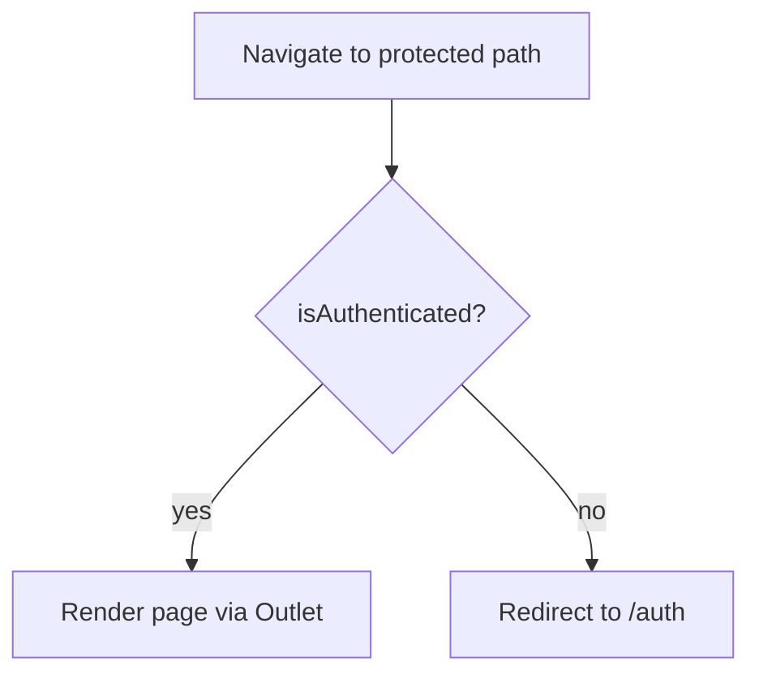
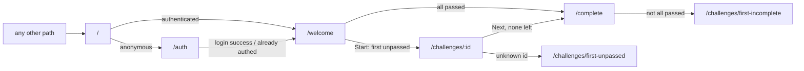

# Routing

Routing is defined entirely in `src/App.jsx` using `react-router-dom` (`BrowserRouter`).

## Route table

| Path | Element | Guarded | Notes |
|---|---|---|---|
| `/` | `RootRedirect` | No | Sends authenticated users to `/welcome`, others to `/auth` |
| `/auth` | `AuthPage` | No | Login / register; redirects to `/welcome` if already signed in |
| `/welcome` | `WelcomePage` | Yes | Walkthrough cards and "start" button |
| `/challenges/:id` | `ChallengePage` | Yes | Lesson + editor for one challenge |
| `/complete` | `CongratsPage` | Yes | Final submission screen |
| `*` | `Navigate to="/"` | No | Unknown URLs fall back to `/` |

## Route guarding

`ProtectedRoute` is a layout route: it renders `<Outlet />` when `useAuth().isAuthenticated` is true, otherwise redirects to `/auth`.



Guarding is client-side only and based on the presence of an access token. A stale or expired token is handled by the axios refresh interceptor ([authentication.md](authentication.md)); the backend enforces real authorization.

## Redirect map



Most programmatic redirects use `replace: true` so the back button doesn't return to a transitional page.

## SPA hosting

Deep links such as `/challenges/abc` must resolve to `index.html` on the host. `vercel.json` rewrites any path without a file extension to `/index.html`:

```json
{ "rewrites": [{ "source": "/((?!.*\\.).*)", "destination": "/index.html" }] }
```
