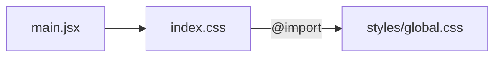
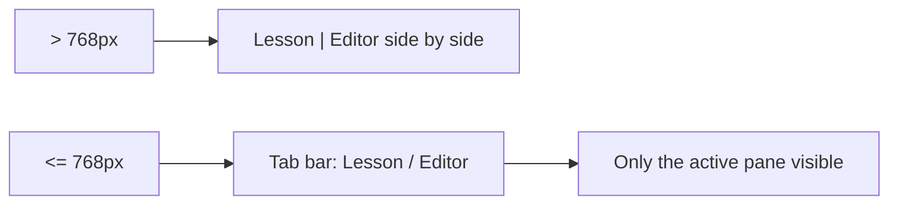

# Styling

Styling is a mix of global CSS (tokens, resets, responsive rules) and inline style objects in components.

## File layout

`src/App.css` is a leftover from the Vite template and is not imported anywhere.

## Design tokens (`styles/global.css`)

CSS custom properties on `:root`:

| Token | Value | Typical use |
|---|---|---|
| `--color-orange` | `#FF600D` | Active state, accents, spinner |
| `--color-gray` | `#333333` | Body text |
| `--color-green` | `#507737` | Completed state, success |
| `--color-blue` | `#003049` | Headings, header bars |
| `--color-stealth` | `#DAD9D9` | Borders, locked state |
| `--color-teal` | `#3B7F82` | Code-block accents |
| `--font-body` | Open Sans | Body copy |
| `--font-heading` | Tahoma | Headings, labels |
| `--font-accent` | Caveat | Decorative text |

Open Sans and Caveat are loaded from Google Fonts in `index.html`. The page background is `#ECEAE3`.

## Conventions

- Components reference tokens through `var(--...)` inside inline style objects.
- Global CSS is used where inline styles can't reach: resets, `.mobile-tab` states, and media queries.
- Some component-specific colors (for example the dark output panel and lesson code blocks) are hard-coded hex values rather than tokens.

## Responsive behavior

Below `768px`:

- The challenge page's lesson/editor split collapses into a tabbed view. `.mobile-tabs` is shown, and `.mobile-hidden` hides the inactive pane. `.mobile-hidden` only has an effect at this breakpoint, so both panes display side by side on desktop.
- The auth page shows `.auth-mobile-brand` branding.

